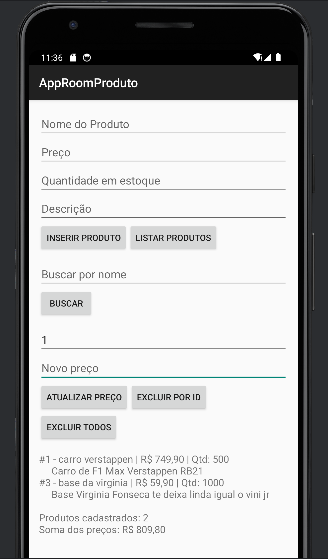

# AppRoomProduto: Cadastro de Produtos com Room SQLite

## Participantes:
**Aluno(a):** Guilherme Caetano dos Santos
**RA:** 242205
**Aluno(a):** Eduarda Gadanha Guerra
**RA:** 172429
**Disciplina:** Programação para Dispositivos Móveis
**Professor(a):** Alessandro Ferreira Paz

## Sobre o projeto:
Aplicativo Android em Kotlin que cadastra e lista produtos usando persistência local com Room (SQLite).

## Imagem do Projeto:

## Tecnologias
- Kotlin
- Room 2.6.1 (SQLite)g
- ViewBinding
- Corrotinas (lifecycleScope)

## Parte B: Questões dissertativas

## B1. O que é persistência de dados? O que aconteceria com uma MutableList?
Resposta: Persistência de dados é a capacidade de um aplicativo guardar informações de forma duradoura, para que elas continuem existindo depois que o app é fechado ou o celular é reiniciado. No projeto, isso acontece quando o productDao.insertAll(product) grava o produto no arquivo SQLite database-name, dentro do armazenamento do aparelho. Por isso, ao fechar o app e abrir de novo, o botão Listar Produtos ainda mostra tudo o que foi cadastrado. Se os produtos ficassem apenas em uma MutableList dentro da MainActivity, eles existiriam só na memória RAM enquanto a Activity estivesse viva. Ao fechar o app, o sistema operacional liberaria essa memória e a lista voltaria vazia na próxima abertura. Pior: mesmo sem fechar o app, uma rotação de tela destrói e recria a Activity, e a lista seria perdida. Ou seja, a MutableList serve para dados temporários, mas não para dados que o usuário espera encontrar depois.

## B2. Diferença entre SQLite direto e Room; duas vantagens do Room
Resposta: Usando o SQLite diretamente, preciso estender a classe SQLiteOpenHelper, escrever na mão os comandos SQL como CREATE TABLE e INSERT, abrir e fechar o banco, e converter manualmente cada linha do Cursor em um objeto, coluna por coluna. O Room é uma camada sobre o SQLite que automatiza grande parte disso: eu descrevo a tabela com uma classe Kotlin (Product) e os comandos com um DAO, e o Room gera o código necessário na compilação, via kapt. A primeira vantagem é a verificação em tempo de compilação: se eu escrever uma consulta errada no @Query, como uma coluna inexistente, o erro aparece ao compilar e não com o app fechando na frente do usuário. A segunda é a redução de código repetitivo: com @Insert, @Update e @Delete o Room cria o SQL sozinho, e converte os resultados direto em List<Product>, sem eu mexer em Cursor. O Room também integra bem com corrotinas (suspend), o que facilita rodar o acesso ao banco fora da thread principal.

## B3. Papel de Entity, DAO e Database
Resposta: A Entity é a classe que representa uma tabela. No projeto, Product está anotada com @Entity, e cada atributo (id, name, price, description, quantity) vira uma coluna, sendo o id a chave primária gerada automaticamente. O DAO (Data Access Object) é a interface com as operações que posso fazer no banco; no projeto, ProductDao tem getAll(), insertAll(), buscarPorNome(), update(), delete() e deleteAll(), cada uma com sua anotação (@Query, @Insert, @Update, @Delete). A Database, AppDatabase, é a classe abstrata anotada com @Database que reúne as entidades (entities = [Product::class]), define a versão do esquema e expõe os DAOs pela função productDao(). A relação entre elas é esta: a MainActivity cria o banco com Room.databaseBuilder, pede o DAO para o AppDatabase e usa o DAO para trabalhar com objetos Product. O banco conhece a entidade, o DAO opera sobre ela, e a tela só conversa com o DAO.

## B4. Thread principal, ANR, suspend e lifecycleScope
Resposta: A thread principal (UI thread) é a responsável por desenhar a tela e responder aos toques do usuário. Se o app acessar o banco nela, e a consulta demorar, a tela fica congelada enquanto o acesso não termina. Por isso o Room bloqueia esse uso e lança o erro “Cannot access database on the main thread”. Se a thread principal ficar bloqueada por cerca de cinco segundos sem responder, o Android considera que o app travou e exibe um ANR (Application Not Responding), uma janela perguntando se o usuário quer fechar ou aguardar o aplicativo. No projeto, o problema é resolvido com duas peças. Ao marcar as funções do DAO como suspend, o Room executa a consulta em uma thread de segundo plano e devolve o resultado quando termina, sem bloquear a tela. E o lifecycleScope.launch { } abre a corrotina que chama essas funções, atrelada ao ciclo de vida da Activity: se a Activity for fechada, a corrotina é cancelada sozinha, evitando trabalho desnecessário e vazamento de memória.

## B5. fallbackToDestructiveMigration() e Migration
Resposta: Quando mudo a estrutura de uma entidade, como ao adicionar o campo quantity e aumentar version para 2, o Room precisa saber como transformar o banco antigo no novo. O fallbackToDestructiveMigration() resolve isso do jeito mais simples: apaga todas as tabelas do banco antigo e cria tudo de novo, ou seja, os produtos já cadastrados são perdidos. Foi o que observei ao testar o item A8. Em desenvolvimento isso é aceitável, mas em um app publicado na Play Store é perigoso, porque uma atualização do aplicativo apagaria os dados de todos os usuários, que perderiam seus registros sem aviso. A alternativa correta é uma Migration, uma classe em que eu informo a versão de origem e a de destino e escrevo o SQL que altera o banco preservando os dados, por exemplo ALTER TABLE product ADD COLUMN quantity INTEGER NOT NULL DEFAULT 0. Assim o esquema é atualizado e os dados antigos continuam existindo.

## B6. ViewBinding versus findViewById
Resposta: Com findViewById, preciso procurar cada componente da tela pelo id e depois converter para o tipo certo, o que gera código repetitivo. O ViewBinding gera automaticamente a classe ActivityMainBinding, com uma propriedade para cada componente do layout, e no projeto acesso tudo por binding.editProductName, binding.btnInserirProduto e assim por diante. A principal vantagem é a segurança em tempo de compilação. Se eu usar um id que não existe, o código nem compila, enquanto com findViewById o erro só apareceria com o app em execução. Ele também evita o erro de tipo (tentar tratar um Button como EditText, que causaria ClassCastException) e o problema de componente nulo, por erro de digitação no id ou por buscar uma view que não está naquele layout. O resultado é um código mais curto, mais legível e com menos falhas em tempo de execução.

## B7. Banco como Singleton
Resposta: No tutorial, o banco é criado dentro da MainActivity, o que funciona porque o app tem uma só tela. Em apps maiores, com várias telas, o recomendado é ter uma única instância de AppDatabase para todo o aplicativo (Singleton), normalmente criada em um companion object com verificação de instância existente. Criar o banco é uma operação cara, pois abre conexões e carrega o esquema, e cada instância mantém suas próprias conexões e seu próprio cache em memória. Se cada tela criasse o seu banco, o app gastaria mais memória e processamento sem necessidade. Além disso, várias instâncias acessando o mesmo arquivo ao mesmo tempo podem causar conflitos de escrita e travamento do banco, e as telas poderiam ficar com dados desatualizados, porque uma instância não avisa as outras quando algo muda. Com uma instância só, todo o app compartilha a mesma conexão, e os dados ficam consistentes entre as telas.

## B8. Reflexão pessoal
Resposta: (Ajuste com o que realmente aconteceu com você.) Minhas principais dificuldades foram de configuração, não de lógica. Na primeira sincronização, o Gradle apresentou erro por incompatibilidade da versão do Android Gradle Plugin (8.7.3) com o meu Android Studio, que aceitava no máximo a 8.5.1. Resolvi ajustando no libs.versions.toml a versão do plugin, e também a do Gradle e do compileSdk, até a sincronização funcionar. Outra dificuldade foi o emulador, que fechava ao iniciar com erro interno do QEMU; Na parte de código, a que exigiu mais atenção foi o item A8: entender que mudar a version com fallbackToDestructiveMigration() apaga os produtos antigos. Um app real em que o Room seria útil é um controle de estoque para uma pequena loja, que precisa funcionar mesmo sem internet. Eu usaria uma entidade de produtos (nome, preço, quantidade) e uma de movimentações de entrada e saída, com consultas para avisar quando a quantidade ficar baixa e para buscar produtos pelo nome, como na busca que implementei. Os dados ficariam salvos no aparelho, e o app poderia sincronizar com um servidor depois, quando houvesse conexão.

(repita para B2 até B8)

## Como executar
1. Clone o repositório
2. Abra no Android Studio
3. Execute em um emulador (API 24+)
